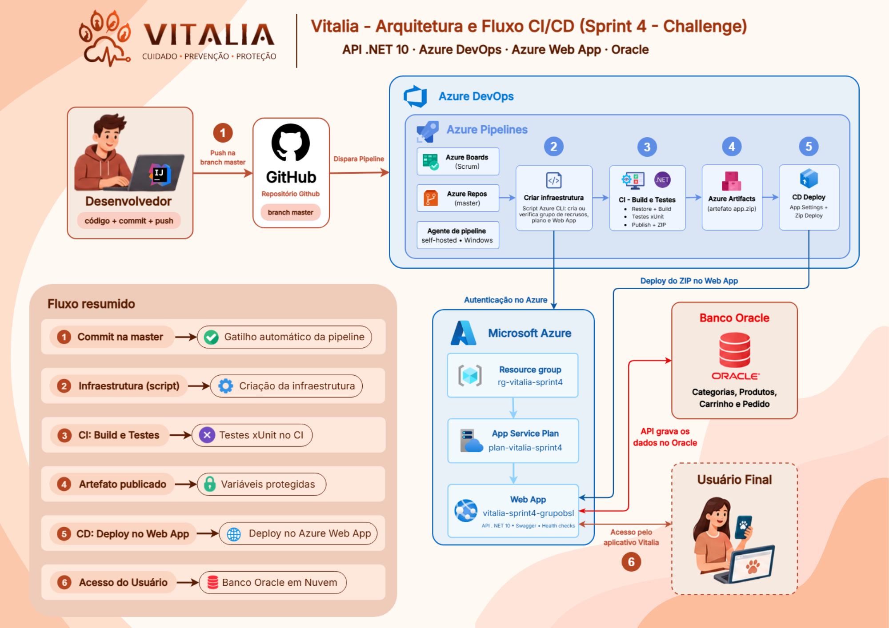

<p align="center">
  
</p>

# 🐾 Vitalia API — Módulo Comercial


**Sprint 4 · DevOps Tools & Cloud Computing · CI/CD com Azure DevOps**

API REST em **ASP.NET Core / .NET 10** do módulo comercial da plataforma **Vitalia** (categorias, produtos, carrinho, checkout e pedidos), publicada no **Azure Web App** por uma pipeline de **CI/CD no Azure DevOps** e persistindo dados em um **Oracle Database em nuvem (Oracle)**.

> A documentação técnica completa da API (entidades, endpoints, autenticação, HATEOAS, status codes) está em [`docs/README-API.md`](docs/README-API.md).

---

## 📑 Índice

- [👥 Integrantes](#-integrantes)
- [🔗 Links](#-links)
- [📚 Descrição da solução](#-descrição-da-solução)
- [🚀 Stack de tecnologias](#-stack-de-tecnologias)
- [🧭 Diagrama de arquitetura CI/CD](#-diagrama-de-arquitetura-cicd)
- [🗄️ Banco de dados em nuvem](#️-banco-de-dados-em-nuvem)
- [☁️ Infraestrutura no Azure](#️-infraestrutura-no-azure)
- [🧰 Projeto no Azure DevOps](#-projeto-no-azure-devops)
- [⚙️ Pipeline de CI/CD](#️-pipeline-de-cicd)
- [🔐 Variáveis protegidas](#-variáveis-protegidas)
- [✅ Como validar a aplicação](#-como-validar-a-aplicação)
- [🧪 Testes automatizados](#-testes-automatizados)

---

## 👥 Integrantes

<table>
  <tr>
    <td width="130">
      
    </td>
    <td>
      <b>Moisés Barsoti Andrade de Oliveira</b><br/>
      <b>RM:</b> 565049 &nbsp;&nbsp;|&nbsp;&nbsp;<b>Turma:</b> 2TDSPO - FIAP <br/>
    </td>
  </tr>
  <tr>
    <td width="130">
      
    </td>
    <td>
      <b>Sofia Siqueira Fontes</b><br/>
      <b>RM:</b> 563829 &nbsp;&nbsp;|&nbsp;&nbsp;<b>Turma:</b> 2TDSPG - FIAP <br/>
    </td>
  </tr>
  <tr>
    <td width="130">
      
    </td>
    <td>
      <b>Manuela de Lacerda Soares</b><br/>
      <b>RM:</b> 564887 &nbsp;&nbsp;|&nbsp;&nbsp;<b>Turma:</b> 2TDSPG - FIAP <br/>
    </td>
  </tr>
</table>


---

## 🔗 Links

| Item | Link |
|------|------|
| Repositório no GitHub | https://github.com/Grupo-BSL-Challenge-FIAP/Vitalia-DevOps-Sprint4 |
| Projeto no Azure DevOps | https://dev.azure.com/Grupo-BSL-Vitalia/Sprint%204%20-%20Azure%20DevOps |
| Vídeo no YouTube | https://youtu.be/A4vxQnqkRtw |
| Aplicação em nuvem (Azure Web App) | https://vitalia-sprint4-grupobsl.azurewebsites.net/ |
| Swagger | https://vitalia-sprint4-grupobsl.azurewebsites.net/swagger/index.html |
| Health check | https://vitalia-sprint4-grupobsl.azurewebsites.net/health/ready |

---

## 📚 Descrição da solução

O **Vitalia** é uma plataforma de saúde e cuidado de pets, com aplicativo mobile, dispositivos de monitoramento e serviços de backend. Esta entrega cobre o **módulo comercial**, uma API .NET responsável por:

- cadastro e consulta de **categorias** e **produtos**;
- **carrinho de compras**, **checkout** e **pedidos**;
- validação de **JWT** emitido pelo backend Java do Vitalia, para identificar o usuário e suas permissões (por exemplo, a role `ADMIN`);
- endpoints de **saúde** (`/health`, `/health/live`, `/health/ready`) e documentação **Swagger**.

O objetivo da Sprint 4 é automatizar o ciclo de entrega: a cada alteração de código na branch `master`, o Azure DevOps compila, executa os testes, gera e publica o artefato e faz o deploy no Azure Web App, sem etapas manuais.

---

## 🚀 Stack de tecnologias

| Camada | Tecnologia |
|--------|------------|
| Linguagem / runtime | C# · .NET 10 · ASP.NET Core Web API |
| Persistência | Entity Framework Core + Oracle.EntityFrameworkCore |
| Banco de dados em nuvem | Oracle Database |
| Autenticação | JWT Bearer (emitido pelo backend Java) |
| Documentação | Swagger |
| Observabilidade | Serilog, Health Checks e OpenTelemetry |
| Testes | xUnit, Moq e Microsoft.AspNetCore.Mvc.Testing |
| Hospedagem | Azure App Service (Web App Windows, plano F1) |
| CI/CD | Azure DevOps Pipelines (YAML) |
| Controle de versão | GitHub e Azure Repos |

---

## 🧭 Diagrama de arquitetura CI/CD



**Fluxo detalhado:**

| Etapa | Onde acontece |
|-------|---------------|
| O desenvolvedor faz commit e push na branch `master` | IDE / Git |
| O push dispara o gatilho da pipeline | Azure DevOps Pipelines |
| CI: restauração de dependências e build da API | Agente de pipeline |
| CI: execução dos testes automatizados (xUnit) | Agente de pipeline |
| CI: publicação da aplicação e compactação em `.zip` | Agente de pipeline |
| CI: publicação do artefato `app` no Azure DevOps | Azure DevOps Artifacts |
| CD: inicia somente após o novo artefato ser gerado | Azure DevOps Pipelines |
| CD: autenticação no Azure pela service connection | Azure DevOps + Microsoft Entra ID |
| CD: gravação das App Settings (variáveis protegidas) | Azure App Service |
| CD: deploy do pacote no Web App (Zip Deploy) | Azure App Service |
| O usuário final acessa a API por HTTPS | Azure App Service |
| A API lê e grava dados no Oracle | Oracle FIAP (nuvem) |
| O JWT é emitido pelo backend Java e validado pela API | Backend Java / API .NET |

**Personas:** desenvolvedor (faz o commit e acompanha a pipeline) e usuário final (consome a API pelo app).

---

## 🗄️ Banco de dados em nuvem

- **Serviço:** Oracle Database da FIAP.
- **Acesso:** a connection string fica em variável protegida da pipeline e chega ao Web App como App Setting. Ela nunca é versionada.
- **Tabelas** (criadas pelas migrations do Entity Framework Core):
  `TB_VITALIA_PRODUCT_CATEGORY`, `TB_VITALIA_PRODUCT`, `TB_VITALIA_CART`, `TB_VITALIA_CART_ITEM`, `TB_VITALIA_ORDERS` e `TB_VITALIA_ORDER_ITEM`.
- **Script DDL:** [`db/script.sql`](db/script.sql), gerado a partir das migrations:

```powershell
dotnet ef migrations script `
  --project Vitalia.Infrastructure/Vitalia.Infrastructure.csproj `
  --startup-project Vitalia.API/Vitalia.API.csproj `
  --context VitaliaDbContext `
  --output db/script.sql
```

---

## ☁️ Infraestrutura no Azure

| Recurso | Valor |
|---------|-------|
| Resource group | `rg-vitalia-sprint4` |
| App Service Plan | `plan-vitalia-sprint4` |
| Web App | `vitalia-sprint4-grupobsl` |
| Runtime | .NET 10 |
| Região | `canadacentral` |

Os recursos foram criados a partir do script documentado em [`infra/criar-infra.ps1`](infra/criar-infra.ps1).

---

## 🧰 Projeto no Azure DevOps

| Configuração | Valor |
|--------------|-------|
| Organização | `Grupo-BSL-Vitalia` |
| Project name | Sprint 4 - Azure DevOps |
| Description | Projeto para entrega da Sprint 4 do professor `Antonio Sergio Rodrigues Figueiredo` e `Karlos Miguel Silva Lima`. Integrantes: RM563829 - Sofia Siqueira Fontes - 2TDSPG / RM565049 - Moisés Barsoti Andrade de Oliveira - 2TDSPO / RM564887 - Manuela de Lacerda Soares - 2TDSPG |
| Visibility | Private |
| Version control | Git |
| Work item process | `Scrum` |
| Acesso do professor | Convidado com nível de acesso **Basic** |

---

## ⚙️ Pipeline de CI/CD

A pipeline é definida em YAML, no arquivo [`azure-pipelines.yml`](azure-pipelines.yml) na raiz do repositório.

**Gatilho:** a cada alteração na branch `master`.

### Estágio CI: Build e testes

| Ordem | Task | O que faz |
|-------|------|-----------|
| 1 | `DotNetCoreCLI@2 restore` | Restaura as dependências |
| 2 | `DotNetCoreCLI@2 build` | Compila a API em modo Release |
| 3 | `DotNetCoreCLI@2 test` | Executa os testes automatizados e publica os resultados |
| 4 | `DotNetCoreCLI@2 publish` | Gera os arquivos publicados da API |
| 5 | `ArchiveFiles@2` | Compacta a aplicação em `app.zip` |
| 6 | `PublishPipelineArtifact@1` | Publica o artefato `app` no Azure DevOps |

### Estágio CD: Deploy no Azure Web App

O estágio depende do CI (`dependsOn`) e só executa depois que o artefato foi gerado.

| Ordem | Task | O que faz |
|-------|------|-----------|
| 1 | `DownloadPipelineArtifact@2` | Baixa o artefato `app` |
| 2 | `AzureAppServiceSettings@1` | Grava as App Settings a partir das variáveis protegidas |
| 3 | `AzureWebApp@1` | Faz o deploy do `app.zip` no Web App (Zip Deploy) |

**Autenticação no Azure:** service connection `azure-vitalia-sprint4` (Azure Resource Manager, workload identity federation).
**Agente de execução:** `self-hosted (pool Default)`.

---

## 🔐 Variáveis protegidas

Valores sensíveis ficam como **variáveis secretas** da pipeline e nunca são versionados.

| Variável | Secreta | Uso |
|----------|---------|-----|
| `OracleConnection` | Sim | Connection string do Oracle (`ConnectionStrings__OracleConnection`) |
| `JWT_SECRET` | Sim | Segredo compartilhado para validar o JWT |
| `ASPNETCORE_ENVIRONMENT` | Não | `Production` |
| `NOME_WEBAPP` | Não | `vitalia-sprint4-grupobsl` |

---

## ✅ Como validar a aplicação

⚠️ Criar, alterar e excluir exigem um JWT com a role `ADMIN`: no Swagger, clique em **Authorize** e informe `Bearer <token>`.

1. Abra o Swagger: https://vitalia-sprint4-grupobsl.azurewebsites.net/swagger/index.html
2. Confirme a saúde da API e do banco em `/health/ready`.
3. Teste o CRUD de **Category** em `/api/Category` (`POST`, `GET`, `GET /{id}`, `PUT /{id}` e `DELETE /{id}`). 
4. Confira cada operação direto no banco:

```sql
SELECT CATEGORY_ID, NAME, DESCRIPTION
FROM TB_VITALIA_PRODUCT_CATEGORY
ORDER BY CATEGORY_ID;
```

---

## 🧪 Testes automatizados

O CI executa os testes a cada alteração na `master`. Para rodar localmente:

```powershell
dotnet test
```

| Projeto | Tipo |
|---------|------|
| `tests/Vitalia.Domain.Tests` | Testes unitários do domínio |
| `tests/Vitalia.Application.Tests` | Testes unitários da camada de aplicação |
| `tests/Vitalia.API.IntegrationTests` | Testes de integração da API |

Os resultados aparecem na aba **Tests** da execução da pipeline.

---
